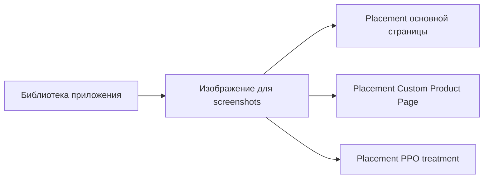

# Аудит изменений App Store Connect API 4.5.1 для asc-mcp

Дата: 15 октября 2026 года. Репозиторий: `asc-mcp` 4.1.6, HEAD `4c26a15e24b9f5deeec686c9419140102467b500`.

Сокращённые пути к Swift-коду ниже отсчитываются от `Sources/asc-mcp/`; соседние файлы одного worker указаны без повторения каталога.

**Главная необходимая работа — поддержка App Asset Library и связанных сценариев ревью.** Apple отделила загруженный файл от его размещения на странице приложения. Текущие 19 инструментов `screenshots_*` работают с прежней моделью sets; новой библиотеки, placements и справочника требований в MCP нет.

Это существенная миграция media-сценариев. Оснований объявлять весь MCP несовместимым нет: все 476 операций Apple, на которые ссылается наш manifest, присутствуют в актуальной спецификации с прежними HTTP-методами и путями. Сохранение пути не гарантирует прежнего поведения сервера.

Apple выпустила API 4.5.1 6 октября 2026 года. Новая модель описана в [release notes 4.5.1](https://developer.apple.com/documentation/appstoreconnectapi/app-store-connect-api-4-5-1-release-notes), дата подтверждена [публикацией релиза](https://developer.apple.com/news/releases/?id=10062026a). В рассмотренных материалах Apple нет даты отключения старых media endpoints.

## Объём и границы аудита

Сопоставлены актуальный каталог документации Apple, release notes всей серии 4.0–4.5.1, руководства по новой Asset Library, загрузке, placements, миграции, справочникам, аутентификации, ошибкам и пагинации, а также текущая полная OpenAPI и исходники затронутых модулей. Машинная инвентаризация охватывает все 1 303 операции спецификации. Подробный анализ поведения сосредоточен на изменениях после нашей базы 4.4.1 и связанных существующих сценариях.

Context7 нашёл официальный индекс ASC, но запрос о новой Asset Library вернул прежние screenshot APIs. Нововведения сверены напрямую с Apple Docs, официальными Markdown-страницами Apple и скачанной OpenAPI.

Это аудит документации и исходного кода. Сборки, тесты, вызовы работающего ASC MCP и операции в аккаунтах Apple не выполнялись. Полного архивного JSON 4.4.1 в checkout нет: приведённые проверки сравнивают нынешний контракт с закреплённым manifest, а не каждое старое поле с архивом. Поэтому выводы о структурной сохранности не являются подтверждением runtime-совместимости.

## Состояние контракта

| Показатель | База репозитория | Apple на дату аудита |
|---|---:|---:|
| Версия API Apple | 4.4.1 | 4.5.1 |
| Пути | 966 | 1 001 |
| HTTP-операции | 1 263 | 1 303 |
| Публичные MCP tools | 502 | Каталог нашего MCP |
| Операции, сопоставленные с tools | 476 | Все 476 найдены |
| Явно отложенные операции | 424 | Все 424 найдены |
| Операции под правилами исключения из scope | 363 | 369 |
| Операции без решения в нынешнем manifest | 0 | 34 |

Из 34 неучтённых операций 33 относятся к Asset Library, одна — к performance overview. Ещё шесть операций модерации Game Center попадают под существующее правило исключения. Чистый рост спецификации — 40 операций; механически превращать каждую в отдельный MCP tool не требуется.

Дополнительно проверено существование 1 244 привязок параметров, 1 076 путей request body и 1 026 путей response body; для 471 фиксированной привязки проверены enum-значения. Отсутствующих адресуемых полей и недопустимых фиксированных значений в этой проверке не обнаружено. Проверка не оценивает все ограничения `required`, nullable, сочетания параметров и бизнес-состояния Apple.

Точный JSON-инвентарь: [операции и результаты структурной сверки](2026-10-15-asc-api-4.5.1-operations.json). Число mapped означает наличие связи в manifest, а не полное покрытие возможностей операции.

Источники базы: `Sources/asc-mcp/Resources/OperationManifest/manifest.json:3`, `Core/ASCCoverageInventory.swift:42`, файлы `Resources/OperationManifest/tools/`. Свежий документ: [официальная OpenAPI](https://developer.apple.com/sample-code/app-store-connect/app-store-connect-openapi-specification.zip).

## Изменения assets

### A01 Новая библиотека и placements

Раньше мы создавали screenshot/preview set для конкретной локализации и display type, затем загружали в него файл. Теперь приложение имеет одну библиотеку. Загруженный image/video существует отдельно; placement связывает его с конкретным местом показа. Один файл можно повторно использовать в совместимых размещениях.

Целевые ресурсы — локализации App Store version, Custom Product Page, PPO treatment и In-App Event. Для screenshots/previews и creative assets используются разные категории; повторное использование допустимо только при совместимости category, specification, placement type и placement group. Это не обещание использовать любой файл в любом месте. [Модель Asset Library](https://developer.apple.com/documentation/appstoreconnectapi/understanding-the-app-asset-library).

В API появились library, images, videos, placements, ordering requests и reference data. Текущий `ScreenshotsWorker` целиком основан на sets; его 19 tools сопоставлены с 24 операциями старой модели. Media для CPP/PPO также проходит через него. `AppEventsWorker` предоставляет девять операций метаданных, но не полный сценарий загрузки event media.

**Необходимые работы:** новый домен Asset Library; явные операции чтения, загрузки и размещения; переходные инструкции для `screenshots_*`; поддержка всех четырёх типов локализаций. Старые `set_id` и `screenshot_id` нельзя молча трактовать как library/placement IDs — это другие сущности и другой контракт удаления.

Код: `Workers/ScreenshotsWorker/ScreenshotsWorker.swift:9`, `ScreenshotsWorker+ToolDefinitions.swift:7`, `ScreenshotsWorker+Handlers.swift:1540`; `Resources/OperationManifest/tools/screenshots.json`, `tools/app_events.json`.

### A02 Требования к файлам становятся динамическими

`GET /v1/appAssetLibraryRefData` возвращает шесть связанных наборов: features, placement groups, image specs, video specs, placement types и display classes. Из них нужно получать размеры, расширения, MIME types, ограничения альфы, видео и количества размещений. `specId` назначает Apple после обработки файла; клиент проверяет его по справочнику.

Для screenshots/previews размеры в specs точные. Для видео учитываются также duration, FPS и необходимость аудиодорожки. Появился `IPHONE_DUO`, но добавление одной константы в наш список display types проблему не решает. Apple может расширять справочник без выпуска новой версии API. [Справочник требований](https://developer.apple.com/documentation/appstoreconnectapi/discovering-asset-specifications).

**Необходимые работы:** загрузка и ограниченное кэширование справочника, обновление при неизвестном spec/group, локальная проверка файлов до первой записи, проверка `specId` после обработки. Доступность определять по фактически возвращённым features. Значения `APPLE_ADS`, `RETENTION_MESSAGING`, `APP_CLIPS` и другие в enum сами по себе не доказывают доступность соответствующих сценариев.

### A03 Загрузка и статусы требуют нового адаптера

Передача байтов сохраняет знакомую схему reservation → multipart upload → commit. В новом commit передаётся `uploaded: true`; `sourceFileChecksum` отсутствует. Signed upload URLs остаются временными, передача идёт без ASC JWT. Бинарное содержимое после commit неизменяемо. [Загрузка изображений](https://developer.apple.com/documentation/appstoreconnectapi/uploading-and-managing-image-assets).

Состояние нового image/video находится в `attributes.state`, причины — в `stateDetails`. Руководство описывает переход обработки `AWAITING_UPLOAD` → `UPLOAD_COMPLETE` → `PREPARE_FOR_SUBMISSION`. В OpenAPI enum дополнительно сохранён `COMPLETE`. Статусы обработки файла, его ревью и placement нужно показывать отдельно: загрузка не означает одобрение или появление в App Store.

У видео poster frame имеет собственную асинхронную обработку. Его изменение влияет на все placements этого видео. Требуется возвращать состояние `previewFrameImage`, ошибки и предупреждения. [Загрузка и управление видео](https://developer.apple.com/documentation/appstoreconnectapi/uploading-and-managing-video-assets).

**Что можно использовать повторно:** `UploadService` с immutable snapshot и передачей частей, HTTP transport, безопасная обработка неизвестного результата записи. **Что адаптировать:** модели, reservation/commit, проверку принадлежности приложению, интерпретацию состояний и recovery. Нельзя переносить существующий polling без изменения: media-адаптер сейчас завершает обработку только на `assetDeliveryState.state == COMPLETE`.

Убирать checksum из общего upload-кода нельзя: другие семейства API продолжают иметь собственные контракты. Локальную проверку неизменности файла нужно сохранить независимо от отсутствия checksum в новом commit.

Код: `Services/UploadService.swift:85`, `Helpers/UploadTransactionRecovery.swift:155` и `:1346`, `Workers/ScreenshotsWorker/ScreenshotsWorker+Handlers.swift:1749` и `:1834`.

### A04 Порядок и удаление имеют другую семантику

Placement создаётся для одного asset и одной целевой локализации; менять его после создания нельзя. Замена изображения означает удаление старого placement, создание нового и восстановление порядка. Удаление placement оставляет файл в library. Удаление asset с оставшимися placements отклоняется.

Порядок задаётся через `POST /v1/appAssetLibraryPlacementOrderingRequests` для одной группы и локализации. Для проверки нужен полный список с `sort=placementGroupPosition`; отдельного числового атрибута позиции в ответе нет. Event localizations этим ordering API не поддерживаются. [Placements и порядок](https://developer.apple.com/documentation/appstoreconnectapi/placing-assets-on-your-app-store-surfaces).

**Необходимые работы:** отдельные операции remove placement, delete asset и archive asset; предварительный просмотр всех использований; проверка точного состава и порядка; восстановление после частичного replace/reorder. Нельзя переносить каскадное удаление sets на общую библиотеку.

Миграцию проводить по приложениям с проверкой результатов. Если часть placements не создана, уже загруженный asset можно использовать при продолжении. Архивирование и удаление имеют ограничения по состояниям, которые нужно проверять отдельно. [Руководство по миграции](https://developer.apple.com/documentation/appstoreconnectapi/migrating-to-the-app-asset-library).

### A05 Ревью должно поддерживать самостоятельные assets

В текущей OpenAPI у `ReviewSubmissionItem` и его create request есть отношения `appAssetLibraryImage` и `appAssetLibraryVideo`. У наших моделей, входных схем, списка includes и проекции результата их нет. При чтении такого элемента существующая проекция не покажет его asset identity: `resource_type` и `resource_id` могут остаться пустыми. Это вывод из кода, без воспроизведения на аккаунте.

**Необходимые работы:** расширить `review_submissions_add_item`, read/list, include/fields, ownership validation и recovery для обоих ресурсов. Проверить смешанные submissions, пагинацию и повторное чтение после ручных действий в ASC.

Самостоятельное ревью возможно после появления одобренной версии приложения; первый комплект assets подаётся вместе с первой версией. Asset, уже участвующий в активной подаче через родительский объект, нельзя одновременно отправить отдельно. Для самостоятельной подачи важен выбор платформы и соответствующей последней версии. [Правила отправки assets на ревью](https://developer.apple.com/help/app-store-connect/manage-submissions-to-app-review/submit-assets-from-asset-library).

Код: `Models/ReviewSubmissions/ReviewSubmissionModels.swift:78` и `:344`, `Workers/ReviewSubmissionsWorker/ReviewSubmissionsWorker+ToolDefinitions.swift:117`, `ReviewSubmissionsWorker+Handlers.swift:19` и `:1473`.

### Дополнительная продуктовая возможность

Creative assets дают изображения и видео для header продуктовой страницы и поисковой выдачи, помимо привычных screenshots/previews. Их можно заранее готовить и одобрять для кампаний. Apple также добавила preview интерфейса страницы, устройств и оформления в ASC. Это новые маркетинговые возможности; наличие UI preview не означает наличие такого же rendering API. [Анонс Apple от 5 октября](https://developer.apple.com/news/?id=ljpl7kyn).

Apple Help описывает новые creative placements для iOS/iPadOS 27+, а также замену approved creative assets на опубликованной странице через UI без новой версии. Последнее нужно отдельно подтвердить для публичного API: руководство placements формулирует ограничение редактируемым родителем. [Управление assets в ASC](https://developer.apple.com/help/app-store-connect/manage-app-information/manage-your-app-store-assets).

## Остальные изменения после 4.4.1

### A06 Возрастной рейтинг Кореи

Apple добавила `ALL` и `TWELVE_PLUS` в `koreaAgeRatingOverride`. Наши tool schema и handler разрешают только `NONE`, `FIFTEEN_PLUS`, `NINETEEN_PLUS`. Новые корректные значения отклоняются локально до HTTP-запроса.

**Работа небольшая и обязательная для актуального контракта:** обновить оба allowlist, соответствующие contract fixtures и описание. Не менять остальные рейтинги попутно.

Код: `Workers/AppLifecycleWorker/AppLifecycleWorker+ToolDefinitions.swift:608`, `AppLifecycleWorker+Handlers.swift:1491`. Источник Apple: [release notes 4.5](https://developer.apple.com/documentation/appstoreconnectapi/app-store-connect-api-4-5-release-notes), schema `AgeRatingDeclarationUpdateRequest` в OpenAPI 4.5.1.

### A07 Подписки для организаций

`Subscription` теперь содержит `marketSettings` и `multiSeatStatus`. Первое различает App Store, Apple School Manager и Apple Business Manager; второе отражает многоместную подписку. В нашей модели и выдаче эти данные отсутствуют, update tool их не передаёт Apple.

В OpenAPI 4.5.1 оба поля есть в `SubscriptionUpdateRequest`, но отсутствуют в `SubscriptionCreateRequest`. Поэтому нельзя просто добавить их ко всем mutations: создание и последующая настройка имеют разные входные контракты.

**Работы:** сначала отображение данных, затем отдельное расширение update и проверки допустимых значений/null. Приоритет зависит от необходимости B2B-подписок в наших продуктах; обычный App Store subscription flow не требует включения B2B.

Код: `Models/Subscriptions/SubscriptionModels.swift:24`, `Workers/SubscriptionsWorker/SubscriptionsWorker+Handlers.swift:1391`; источники: [Subscription](https://developer.apple.com/documentation/appstoreconnectapi/subscription), [SubscriptionUpdateRequest](https://developer.apple.com/documentation/appstoreconnectapi/subscriptionupdaterequest), [release notes 4.5](https://developer.apple.com/documentation/appstoreconnectapi/app-store-connect-api-4-5-release-notes).

### A08 Обзор производительности

Новый `GET /v1/apps/{id}/performanceOverviews` возвращает агрегированную картину производительности. Это отдельная операция, не alias существующего `perfPowerMetrics`. В схеме `xcodeOverview` есть `appMetadata`, `insights`, `categories`, `signatures` и `telemetryIdentifier`.

**Работы:** новый read-only tool в `MetricsWorker`, фильтр device type, корректный `Accept: application/vnd.apple.xcode-overview+json`, понятная проекция сводки и поведение при отсутствии данных. Доступность и состав данных по конкретному приложению требуют отдельного чтения API. [Описание endpoint](https://developer.apple.com/documentation/appstoreconnectapi/get-v1-apps-_id_-performanceoverviews).

Существующие `ANIMATION` и `STORAGE` уже поддержаны: `Workers/MetricsWorker/MetricsWorker+ToolDefinitions.swift:12`. Повторно включать их в новую разработку не нужно.

### A09 App tags и Game Center

Для app tags Apple объявила deprecation связи с territories и изменение соответствующих параметров. App tags у нас уже находятся в deferred, поэтому это не обнаруженная регрессия работающего tool. При последующей реализации надо использовать актуальный контракт и разрешить расхождение документации со спецификацией.

Game Center получил шесть операций для модерации scores и blocked players. Они попадают под наш существующий out-of-scope. Их следует учесть в обновлённой инвентаризации, но не включать автоматически в миграцию assets. [Release notes 4.5](https://developer.apple.com/documentation/appstoreconnectapi/app-store-connect-api-4-5-release-notes).

## Состояние остальных направлений

| Направление | Результат сверки | Значение для следующих работ |
|---|---|---|
| Auth, HTTP, ошибки, pagination | Нового обязательного протокола авторизации в 4.5/4.5.1 не объявлено; текущие bindings сохранились | Повторно использовать инфраструктуру, проверить особенности новых ресурсов |
| App metadata, lifecycle, pricing, accessibility | Текущие mapped endpoints существуют; конкретный новый пробел — Korea override и media | Точечная адаптация вместо переписывания домена |
| TestFlight, builds, build uploads, feedback | Современные workers уже есть; новые 4.5/4.5.1 release notes не объявляют их замену | Регрессионная проверка при интеграции, beta App Clip остаётся прежним backlog |
| IAP и subscription metadata versions | Versioned API 4.4.1, соответствующие localization/image tools и review handoff уже реализованы | Сохранить; отдельно добавить поля организаций |
| Subscription plan availability | Новая модель 4.4 уже реализована, legacy aliases явно обозначены | Не повторять завершённую миграцию |
| Metrics, analytics, sales/finance | Имеющиеся операции сохранены; performance overview отсутствует | Добавить overview, остальные пробелы оценивать отдельно |
| Xcode Cloud | 42 публичных tools и 42 mapped операции | Нет подтверждённой необходимости миграции из-за 4.5.1 |
| Webhooks | Текущий enum событий совпадает с нашей моделью | Asset Library events в нём нет; ожидание обработки не строить на вымышленном webhook |
| Provisioning, Users, Sandbox | Сохранены mapped методы и пути | Apple Pay/Wallet и другие deferred возможности — отдельный backlog |
| Background Assets | Upload/version/release API остаётся deferred | Это отдельные пакеты контента приложения, не маркетинговая Asset Library |
| Android to iOS mapping | Возможность 4.2 уже существует у Apple, у нас deferred | Полезность для fleet оценить отдельно от media |
| Game Center, alternative distribution | 369 операций попадают под существующие scope rules | Сохранить явное решение о границе продукта |

Таблица показывает состояние покрытия и объявленные изменения, а не результаты выполнения каждого endpoint. Старые 424 deferred операции не стали новыми проблемами из-за релиза 4.5.1. В частности, Background Assets, App Clips, app tags и Android mapping нужно рассматривать отдельно от обязательной совместимости.

Проверены [релизы 4.0](https://developer.apple.com/documentation/appstoreconnectapi/app-store-connect-api-4-0-release-notes), [4.1](https://developer.apple.com/documentation/appstoreconnectapi/app-store-connect-api-4-1-release-notes), [4.2](https://developer.apple.com/documentation/appstoreconnectapi/app-store-connect-api-4-2-release-notes), [4.3](https://developer.apple.com/documentation/appstoreconnectapi/app-store-connect-api-4-3-release-notes), [4.3.1](https://developer.apple.com/documentation/appstoreconnectapi/app-store-connect-api-4-3-1-release-notes), [4.4](https://developer.apple.com/documentation/appstoreconnectapi/app-store-connect-api-4-4-release-notes) и [4.4.1](https://developer.apple.com/documentation/appstoreconnectapi/app-store-connect-api-4-4-1-release-notes). Доказательства реализации: соответствующие worker manifests и `CHANGELOG.md`; social-media age-rating fields, versioned commerce и новые metric categories присутствуют в исходниках.

## A10 Проверка актуальности API тоже требует обновления

Наш manifest жёстко закрепляет версию, SHA-256 и количество операций 4.4.1. CI скачивает latest specification и запускает `openapi-contract-check --strict`. Текущий документ 4.5.1 не может пройти эти проверки pin без изменений. Это вывод из workflow и analyzer; конкретный GitHub run в рамках аудита не проверялся.

Простая замена версии и hash недостаточна. Нужно принять решения по 34 новым неучтённым операциям, пересмотреть истёкшие `reviewAtSpec`, optional-input coverage и обновить coverage-документ. При этом изменения в бизнес-контрактах должны быть реализованы или явно отложены, а не скрыты новым pin.

Есть два подтверждённых расхождения источников Apple:

1. Release notes 4.5.1 объявляют screenshot/preview/event-media ресурсы deprecated; в свежем OpenAPI, например, у `POST /v1/appScreenshots` и `POST /v1/appPreviewSets` отсутствует `deprecated: true`.
2. Release notes 4.5 меняют territories для app tags, но OpenAPI 4.5.1 всё ещё содержит `include=territories`, `fields[territories]` и `limit[territories]` у списка app tags.

**Работы:** дополнить OpenAPI-проверку поддерживаемым списком семантических deprecations и просмотром release notes. Полезно хранить воспроизводимый baseline и отдельно отслеживать latest; выбор CI-политики можно принять в плане. Не считать отсутствие `deprecated` доказательством актуальности API.

Код: `.github/workflows/ci.yml:232`, `Tooling/ASCOperationToolAnalyzer.swift:427`, `Tooling/ASCOpenAPISpec.swift:166`, `Resources/OperationManifest/manifest.json:3`.

## Приоритеты для будущего плана

| Приоритет | Пакет работ | Результат для пользователя MCP |
|---|---|---|
| Первый | Asset Library, справочники, upload и обработка | Можно загрузить один файл и получить проверенный asset |
| Первый | Placements, порядок, безопасная замена и удаление | Можно собрать media для основной страницы, CPP, PPO и events |
| Первый | Review submissions для images/videos | Можно читать и отправлять новые assets на ревью в разрешённых состояниях |
| Вместе с переходом | Manifest, deprecations, документация и совместимость `screenshots_*` | Старые клиенты получают предсказуемый переход, актуальный контракт виден в проверках |
| Небольшая обязательная адаптация | Korea `ALL` и `TWELVE_PLUS` | Новые значения не блокируются MCP |
| Следующий полезный прирост | Performance overview | Доступна сводка производительности перед выпуском |
| По потребности продукта | B2B subscriptions | Видны и управляемы markets и multi-seat |
| Отдельное решение | Background Assets, Android mapping, App Clips, Game Center и остальной deferred backlog | Расширение продукта без смешения с миграцией media |

Предпочтительная архитектура — отдельный worker, например `assets`, с явными asset/placement IDs и повторным использованием существующего transfer/recovery-кода. `screenshots_*` на переходный период сохраняет старый контракт и сообщает о replacement tools. Точное число новых tools следует определить по пользовательским сценариям: один upload tool может объединять несколько HTTP-операций.

Критерий полноты первой поставки: **загрузить → дождаться обработки → проверить спецификацию → разместить → упорядочить → перечитать → при необходимости отправить на ревью → безопасно заменить или удалить**, включая продолжение после частичного сбоя.

## Вопросы для проверки при реализации

- Legacy/new coexistence: как уже опубликованные screenshots представлены в Asset Library и как изменения одного API видны в другом. Документация не даёт оснований обещать автоматическую конверсию наших IDs или восстановление исходных файлов.
- Фактические состояния `COMPLETE` и `PREPARE_FOR_SUBMISSION`, пустые/nullable поля во время обработки, задержка video poster frame. В схемах есть `oneOf`/discriminator и повторные ссылки на common attributes; decoder нельзя принимать только по счастливому примеру.
- Какие ошибки и допустимые состояния возвращает delete/archive; можно ли менять poster frame после approval. API guide и UI Help описывают ограничения с разной детализацией.
- Поддерживает ли публичный API публикацию approved creative assets на уже опубликованной версии так же, как UI. Пока не включать этот сценарий в обещанное поведение.
- Права конкретного API key: API guide указывает Account Holder/Admin/App Manager, тогда как UI управления assets также упоминает Marketing. UI permission не доказывает API permission.
- Повторный upload после неизвестного результата, частичный batch, перестановка одновременно с ручным редактированием, asset с placements в нескольких локализациях, чужое приложение, отсутствующая feature и устаревший справочник.

После реализации нужны contract fixtures и реальные MCP-сценарии на разрешённом приложении. Для первой миграции выбрать редактируемую версию и подтвердить результат чтением placements и отображением в ASC. Успешная загрузка байтов, одобрение asset и публикация его placement — разные результаты.

## Приложение с новыми операциями

33 операции Asset Library складываются из следующих групп:

| Группа | Операции |
|---|---:|
| Получить library приложения и её relationship ID; прочитать library | 3 |
| Списки images/videos и их relationship IDs в library | 4 |
| Создание, чтение, обновление и удаление image/video | 8 |
| Создание, чтение и удаление placement | 3 |
| Размещения image/video и их relationship IDs | 4 |
| Размещения четырёх типов локализаций и их relationship IDs | 8 |
| Ordering request | 1 |
| Коллекция reference data и чтение по ID | 2 |
| **Всего** | **33** |

Полные методы, пути, operation IDs и нынешние решения по всем 1 303 операциям сохранены в JSON-приложении. Оно также содержит шесть новых Game Center moderation операций и performance overview.

SHA-256 распакованной официальной OpenAPI 4.5.1: `7518d3a94a8bd701ac25c1c601b95b8f53aad92091affb15a2a9d331713dac1a`. SHA-256 baseline из manifest: `ed0202ef37155b9334772482d2ea0be688c3046b284c895bcbea5455fbe54fd8`.

Локальные снимки источников и промежуточные результаты находятся в `.build/asc-api-audit-2026-10-15/`. Они не меняют runtime-конфигурацию или исходники сервера.
